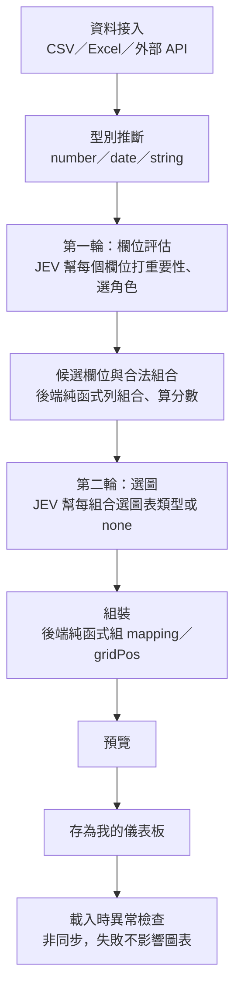

# JEV 智慧化產製儀表板的流程與方法

這份文件寫給想理解、甚至想在別的專案重用這套做法的人，不限於這個 codebase。範例引用的檔案都在 `backend/src/main/java/jev/dashboard/`。

## 1. 目的與核心想法

JEV 只負責「判斷」：這個欄位重不重要、扮演什麼角色、這組欄位該選哪種圖、資料有沒有異常。圖表合不合法、資料怎麼彙總、版面怎麼排，全部交給後端的固定規則決定，模型完全不碰這幾件事。

這樣分工的好處：同一份資料、同一組答案，永遠組出同一份配置，結果可重現；就算 JEV 選了一個不合邏輯的組合（例如把兩個分類欄位硬湊成散佈圖），後端的規則表裡根本沒有這個組合，也就畫不出不合理的圖。

## 2. 整體流程圖



## 3. 資料接入與型別推斷

三種資料源：

- **CSV**：先試 UTF-8（有沒有 BOM 都可以），解碼失敗才改用 MS950。
- **Excel**：預設讀第一個工作表，上傳時可以指定工作表名稱（大小寫不分）。`.xlsx` 用 SAX 串流讀，整本活頁簿不會一次進記憶體；`.xls` 檔案本來就有 65536 列的上限，照舊用 POI usermodel 一次讀。
- **外部 API**：host 要在允許清單裡（SSRF 防線）、不跟隨 redirect、header 只認得 `${DS_XXX}` 這種寫法並在呼叫當下才從環境變數取值、網址不能帶帳密或帳密類的 query 參數。

CSV 和 Excel 都拿第一列當標題，標題不能空白也不能重複；外部 API 沒有標題列，欄位名稱是所有資料列的 JSON key 取聯集而來。

型別推斷（`datasource/SchemaInference.java`）對每個欄位的所有非空值做判斷，依序試：

1. 全部符合數字格式 → `NUMBER`。
2. 否則全部符合日期格式 → `DATE`。
3. 都不是 → `STRING`。

數字格式是 `[-+]?(0|[1-9]\d*)(\.\d+)?`（千分位逗號會先去掉再比對）：**開頭是 0 又接著其他數字的字串不算數字**，所以手機號碼 `0912345678`、統一編號 `04595257`、工號 `007` 都會保留成文字，不會被當成數字而弄丟開頭的 0。日期格式要求西元 4 碼年份加 `-` 或 `/` 分隔，所以民國年（`113/09/24`）或不帶分隔符號的 8 碼日期（`20240924`）目前都抓不到——後者甚至會先被數字格式吃掉，變成 `NUMBER`（這點列進了 `docs/backlog.md`）。

**敏感欄位**：使用者在資料源列表裡手動勾選。勾了之後，這個欄位還是會告訴 JEV 它的名稱和型別，但相異值數量、樣本值都不會送出去；用到這個欄位的卡片，之後也不會做異常檢查（見第 9 節）。

## 4. 第一輪：欄位評估

送給 JEV 的 `state` 是 schema 加總筆數，敏感欄位只留名稱和型別：

```json
{
  "rowCount": 3200,
  "fields": [
    { "name": "訂單日期", "type": "date", "distinctCount": 180, "samples": ["2024-01-05", "2024-01-06", "2024-01-08"] },
    { "name": "地區", "type": "string", "distinctCount": 6, "samples": ["北區", "中區", "南區"] },
    { "name": "金額", "type": "number", "distinctCount": 950, "samples": ["1200", "3400", "890"] },
    { "name": "客戶信箱", "type": "string" }
  ]
}
```

（範例裡「客戶信箱」被標成敏感欄位，物件裡就沒有 `distinctCount`、`samples` 這兩個 key，不是留空，是整個不送。）

每個欄位問兩題，key 用索引不用欄位名（欄位名可能有中文、空白或符號，後端自己會對回欄位）：

```json
{
  "imp_0": { "type": "score", "instructions": "欄位「訂單日期」對分析這份資料有多重要？",
             "criteria": ["不重要，略過", "次要", "重要", "核心指標"] },
  "role_0": { "type": "choice", "instructions": "欄位「訂單日期」在圖表裡適合扮演什麼角色？",
              "criteria": { "dimension": "分類維度，用來分組，例如地區、產品",
                            "measure": "數值指標，可以加總或平均，例如金額、數量",
                            "time": "時間，例如訂單日期",
                            "ignore": "忽略，例如流水號、備註" } },
  "imp_2": { "type": "score", "instructions": "欄位「金額」對分析這份資料有多重要？",
             "criteria": ["不重要，略過", "次要", "重要", "核心指標"] },
  "role_2": { "type": "choice", "instructions": "欄位「金額」在圖表裡適合扮演什麼角色？",
              "criteria": { "...同上..." } },
  "chart_count": { "type": "score", "instructions": "這份資料適合做成幾張圖表？",
                   "criteria": ["1 張", "2 張", "3 張", "4 張", "5 張", "6 張"] }
}
```

（每個欄位都是一組 `imp_i`／`role_i`，這裡只示範 2 個欄位；4 個欄位實際上會有 `imp_0`～`imp_3`、`role_0`～`role_3`。）

JEV 的回答：

```json
{
  "imp_0": { "type": "score", "score": 2.6 },
  "role_0": { "type": "choice", "choice": "time", "confidence": 0.93 },
  "imp_2": { "type": "score", "score": 3.0 },
  "role_2": { "type": "choice", "choice": "measure", "confidence": 0.97 },
  "chart_count": { "type": "score", "score": 1.0 }
}
```

`score` 是從 0 起算的小數（4 個選項回 0 到 3），不是選項文字。`chart_count` 換算張數 K：`round(score) + 1`，夾在 1 到 6 之間；上例 K = 2。

角色判斷還有兩層防呆（`jev/ConfigAssembler.java` 的 `evaluate`）：`confidence` 低於 0.5 就當成 `ignore`；選了 `measure` 但欄位型別不是 `NUMBER`、或選了 `time` 但型別不是 `DATE`，也一律改判 `ignore`——JEV 可能誤判，但不會因此把文字欄位硬拿去加總。

## 5. 候選與組合

**候選欄位**：角色不是 `ignore`、重要性 `round(score) >= 1` 的欄位，依重要性由高到低排序，最多取前 8 個（`MAX_CANDIDATES`）。

**合法組合**：後端把候選欄位兩兩配對、三個一組，再加上雷達圖的特例，對照下表決定每組能畫哪些圖：

| 角色組合 | 合法圖表 |
|---|---|
| time × measure | `line`、`bar` |
| dimension × measure | `bar`、`pie`（dimension 相異值 ≤ 8 才加 `pie`） |
| measure × measure | `scatter` |
| dimension × 3～8 個 measure | `radar`（僅當候選欄位裡 measure ≥ 3 個；dimension 相異值 ≤ 5） |
| time × dimension × measure | `stacked_bar`、`heatmap`（dimension 相異值 ≤ 10 才兩個都給，否則只給 `heatmap`） |
| dimension × dimension × measure | 同上 |

不合上面任何一列的組合直接不產生。

每組的分數是組內欄位重要性的**平均**，不是加總——如果用加總，三欄的組合幾乎永遠比兩欄高分（多一個正的重要性分數就多加一點），最後永遠是三欄組合排前面；用平均，一組真正重要的兩欄還是可能贏過一組欄位普通的三欄。

所有組合依分數由高到低排序，同分時維持產生時的順序（先兩欄組合，再雷達，再三欄組合），取分數最高的 `2K` 組（K 是上一輪算出的張數）。

`table`（明細表）不經過 JEV：每份儀表板最後固定加一張，欄位是候選欄位依重要性排序；如果連候選欄位都沒有，就用資料源的全部欄位。

## 6. 第二輪：選圖

每組候選組合問一題 `choice`，選項是這組合法的圖表類型，外加一個 `none`：

```json
{
  "combo_0": {
    "type": "choice",
    "instructions": "用這組欄位畫一張圖：訂單日期（時間）、金額（數值）。選最適合的圖表類型；如果這組欄位不值得畫，選 none。",
    "criteria": {
      "line": "折線圖：看數值隨時間的變化",
      "bar": "長條圖：比較各分類或各期的數值",
      "none": "這組欄位不值得畫圖"
    }
  }
}
```

回答例如：

```json
{ "combo_0": { "type": "choice", "choice": "line", "confidence": 0.88 } }
```

## 7. 組裝

依照組合的排名順序處理每一題，直到湊滿 K 張圖為止：

1. **丟棄規則**：答案是 `none`、`confidence` 低於 0.5、或選的類型不在這組合法清單裡（防呆用，正常不該發生），這組就跳過，不產生圖表。
2. 剩下的依組合分數排序（第 5 節已經排過），取夠 K 張就停。
3. 依欄位角色決定 `mapping`：有時間欄位的組合優先把時間放在 `x`；`stacked_bar` 沒有時間欄位時，兩個 dimension 裡相異值較少的那個當 `series`；`aggregate` 預設 `sum`（`scatter` 是 `none`）；`timeGrain` 依時間欄位的跨度自動決定——90 天內用 `day`，超過 3 年用 `quarter`，其餘用 `month`。
4. 版面：每列排兩張（各佔 `w:6`、`h:4`），由上往下排；明細表放最後，佔整列（`w:12`、`h:5`）。

如果 JEV 選出來的圖一張都不剩，畫面上只會有明細表，上方顯示「找不到適合的圖表」。

## 8. 萬用轉換器

`transform/UniversalTransformer.java` 依 `type` 把資料轉成統一格式（`dimensions` + `rows`）：

| 圖表 | dimensions | 一列資料 | 說明 |
|---|---|---|---|
| `bar`／`line`／`pie` | `[x, value 或 "count"]` | `[x 值, 聚合結果]` | 依 `x` 分組聚合；有 `timeGrain` 照時間排序，沒有則照數值高低排序 |
| `stacked_bar` | `[x, series, value 或 "count"]` | `[x 值, series 值, 聚合結果]` | 依 `(x, series)` 分組聚合 |
| `heatmap` | `[x, y, value 或 "count"]` | `[x 值, y 值, 聚合結果]` | 依 `(x, y)` 分組聚合 |
| `scatter` | `[x, y]` | `[x 值, y 值]` | 不聚合，逐筆列出；`x` 或 `y` 是 null 的列直接丟掉 |
| `radar` | `[series, measure1, measure2, ...]` | `[series 值, 各 measure 的聚合結果]` | 依 `series` 分組，每個 measure 各自聚合；`aggregate: none` 一樣視同 `sum`，不會列出原始資料 |
| `table` | `columns[]` | 對應欄位的原始值 | 不聚合，最多 500 筆 |
| `bar`／`line`／`pie`／`stacked_bar`／`heatmap` 但 `aggregate: none` | 同該圖表的 dimensions | 對應欄位的原始值 | 不分組，逐筆列出 |

`aggregate` 可以是 `sum`／`count`／`avg`／`none`；`count` 時 `value` 可以省略，直接算筆數。

卡片的 `mapping` 只要引用到資料源裡已經不存在的欄位（資料源改版、欄位被刪掉），這張卡片就整張回傳 `{"error":"FIELD_MISSING","missingField":"<欄位名>"}`，不影響同一份儀表板裡的其他卡片。「欄位存不存在」看的是目前抓回來的資料列裡有沒有任一列帶這個 key（多列的聯集），不是只看第一列，因為外部 API 常常省略值是 `null` 的欄位。

明細表最多回 500 筆，被截斷時多一個 `"truncated": true`；沒被截斷就完全不會有這個欄位（不是 `false`，是整個 key 不存在）。

## 9. 異常檢查

每次載入儀表板，圖表先畫出來，前端再非同步呼叫一次 `/api/jev/highlight/{dashboardId}`，失敗或逾時都不影響已經畫好的圖。

**哪些卡片會檢查**：用到任何敏感欄位的卡片整張跳過；剩下的卡片裡，只有已經彙總過（`aggregate` 不是 `none`）、有 `timeGrain`、類型是 `line`／`bar`／`stacked_bar`／`heatmap` 的才會被摘要。原始資料列（`table`、`scatter`、`radar`，或 `aggregate: none`）一律不檢查，因為那些本來就是投影過的原始資料。

**摘要怎麼做**：拿最後兩個「已經結束」的期間比較——今天所在的那一期還沒結束，跟更後面的期都不算，只比已經結束的兩期（少於兩期就整張跳過）。每個 series 列出兩期的數值和變化百分比（`(本期－前期)／|前期| × 100`，前期是 0 時給 null）。series 超過 10 個時，只留變化量（`|本期－前期|`）最大的 10 個，其餘加總成一個「其他」；如果資料裡本來就有一個真的叫「其他」的 series 又剛好在前 10 名，其餘的併進它，不會覆蓋掉。

所有卡片的題目併成一次請求，每張卡片兩題：

| key | 型別 | 說明 |
|---|---|---|
| `anomaly_<chartId>` | `noul` | 這張卡片最新一期和前一期相比，有沒有值得標註的異常？ |
| `severity_<chartId>` | `score` | 嚴重程度，選項 `["正常波動", "值得注意", "需要關注", "嚴重警示"]` |

`noul` 大於 0.7 才在卡片上顯示標註，嚴重度用 `round(score)` 對應到上面四個等級（夾在 0 到 3 之間）。

結果依（`dashboardId`、資料指紋、今天日期）用 Spring `@Cacheable` 快取在記憶體，資料指紋是所有「沒用到敏感欄位」卡片的 ChartData 雜湊值。今天的日期也是 key 的一部分，因為換一天，「哪一期還沒結束」就會跟著變，就算資料沒變也要重算。只有成功的結果會被快取，失敗不快取，代表 JEV 掛掉時每次載入都會重打一次（列進了 `docs/backlog.md`）。

## 10. 為什麼分兩輪

ERP 資料常見 20 到 50 個欄位。50 個欄位兩兩組合就有 1225 組，若不篩選直接為每個組合各問一題，一次請求的 state 加所有題目很容易超過 JEV 單次請求 64k token 的上限。

拆成兩輪解決這個問題：第一輪先把欄位收斂到最多 8 個候選（重要性加角色篩選），還沒進入組合爆炸就先減量；第二輪只針對這最多 8 個候選欄位的組合發問，而且再取分數最高的 `2K` 組（K 最多 6，等於最多問 12 題）。不管原始資料有幾欄，兩輪加起來的題數都收斂在小範圍內。

## 11. 隱私與安全設計

送給 JEV 的內容只有三種，原始資料列永遠不送：

1. 第一輪的 `state`：欄位名稱、型別、相異值數量、5 筆樣本值、總筆數；敏感欄位只留名稱和型別。
2. 第二輪的組合描述：欄位名稱和角色的文字敘述，不含任何資料值。
3. 異常檢查摘要：每個 series 兩期的聚合數值和變化百分比，最多 10 個 series 加一個「其他」。

呼叫外部系統的秘密只認 `DS_` 開頭的環境變數，值在呼叫當下才從 Spring Environment 讀出來，不存進資料庫、不寫進網址；資料庫密碼、JEV 金鑰這類其他機敏設定就算格式寫對了也讀不到。外部 API 的網址不能帶帳密或帳密類的 query 參數。

JEV 或外部 API 呼叫失敗時，回給使用者的 502 只帶 HTTP 狀態碼（例如「JEV 呼叫失敗（HTTP 500）」），不會把上游回應內容原樣轉出去，避免上游錯誤訊息裡剛好夾帶敏感內容。

## 12. 失敗時的行為

| 狀況 | 行為 |
|---|---|
| 沒有設定 `TYPESAFE_API_KEY` | 503「未設定 TYPESAFE_API_KEY」，連 HTTP 請求都不會發 |
| JEV 呼叫失敗（非 2xx、沒有 answers、連不上） | 502，訊息只帶狀態碼或「無法連線」；分析時直接把錯誤丟給使用者，不產生配置 |
| 異常檢查呼叫 JEV 失敗 | 後端記兩行 WARN（`JevClient` 呼叫失敗當下先記一行、含堆疊追蹤；`HighlightService` 接住例外後再記一行），回傳 `null`，controller 轉成空陣列；圖表照常顯示，只是沒有標註 |
| 一張圖都沒選出來（見第 7 節丟棄規則） | 只產生固定的明細表，畫面顯示「找不到適合的圖表」 |

## 13. 限制與後續方向

這份文件只涵蓋現有規則怎麼運作；已知的缺口、待改善項目和之後想做的功能構想（例如分析前先讓使用者輸入需求、事後用對話方式加圖表）整理在 [`docs/backlog.md`](backlog.md)。
